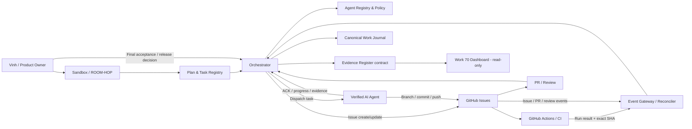

# TD-118-012 — KIẾN TRÚC HAI QUY TRÌNH KHÉP KÍN SANDBOX–GITHUB

- **Work:** W118 — HQTT GitHub Workflow Automation
- **Document ID:** TD-118-012
- **Tên tiếng Việt:** Kiến trúc điều phối vòng đời Task và vòng đời mã nguồn giữa Sandbox–GitHub
- **Tên tiếng Anh:** Sandbox–GitHub Dual Closed-Loop Architecture
- **Phương án nền:** A — Sandbox khởi phát, GitHub kiểm soát phiên bản
- **Trạng thái:** OWNER-DIRECTED BUILD BASELINE — BUILD AUTHORIZED BY VINH — PRODUCT ACCEPTANCE PENDING
- **Phạm vi:** Hai quy trình A/B, trạng thái, quyền, hợp đồng dữ liệu, sự kiện, lỗi, bằng chứng và kế hoạch kiểm thử.
- **Ngày lập:** 2026-11-21 (UTC+07:00)
- **Nguồn đối chiếu:** Issue #65; W118 README/STATUS; RA-118-001; TD-118-004..008; BB-118-002; role-map; workflow và test matrix hiện hành.
- **Git snapshot tại thời điểm đối chiếu:** `main` và `work/118-auto-e2e-v2` DIVERGED, 286 commits ahead / 84 behind; merge base `cf2537e07bfd71d5823bd98f8673b3ab5644fcdc`. Không thực hiện đồng bộ nhánh trong tài liệu này.

> Vinh đã chỉ thị ngày 2026-11-21: “xây đi Xu theo ý mình chưa cần phản biện”. Xu được quyền tự quyết định kỹ thuật và triển khai theo kiến trúc này trên nhánh W118. Không cần chờ phản biện đa tác nhân để bắt đầu BUILD. Quyền này không bao gồm thay đổi quyền/secrets/branch protection, sửa schema Work 70, merge vào main, phát hành hoặc tự nghiệm thu sản phẩm.

---

## 1. Quyết định kiến trúc

### 1.1 Phương án A được chọn

**Sandbox/ROOM-HOP là nơi khởi phát và điều phối công việc. GitHub là hệ thống kiểm soát phiên bản và thực thi CI.** Hai hệ thống kết nối bằng sự kiện có định danh, hợp đồng dữ liệu versioned và cơ chế đối soát.

- Sandbox tạo Work Plan, Work Package (WP), Task; W118 dùng một Task Register riêng theo mẫu DOC-093 của Work 70 (DOC-056 §9), không dùng ID của W70. Task Register trong Sandbox là nguồn chuẩn; SQLite runtime store là transactional adapter/event log, không phải một Task Register cạnh tranh.
- GitHub lưu Issue, Branch, Commit, Push, Pull Request (PR), Review và GitHub Actions; là nguồn sự thật cho lịch sử mã nguồn và kết quả CI.
- GitHub Issue là bản ghi cộng tác/đối soát của Task, không thay thế Task record trong Sandbox.
- Dashboard Work 70 chỉ đọc dữ liệu đã chuẩn hóa từ nguồn được ủy quyền; W118 không tạo Dashboard thứ hai và không tự ý mở rộng schema W70.
- Mọi thay đổi trạng thái phải có event/evidence; không suy diễn trạng thái từ một nhãn hoặc một comment đơn lẻ.

### 1.2 Hai vòng khép kín

**Quy trình A — Plan-to-Task Orchestration**

`Plan → WP → Task → Issue → Select Agent → Dispatch → ACK → Start → Execute → Verify → Accept/Close`

Vòng A trả lời: *việc gì cần làm, ai được giao, ai đã nhận, đang ở đâu, bằng chứng nào cho phép đóng?*

**Quy trình B — Sandbox–GitHub Source/CI Loop**

`Approved Task → Sync Base → Branch → Code/Test → Commit/Push → GitHub CI → PASS/FAIL → Sandbox Reconcile → Review → Acceptance Gate`

Vòng B trả lời: *mã nào được sửa, trên nhánh nào, commit nào đã push, CI đã kiểm tra SHA nào, lỗi được trả về Task nào?*

Hai vòng liên kết qua `work_id`, `wp_id`, `task_id`, `issue_id`, `assignment_id`, `branch`, `commit_sha`, `run_id`, `pr_id` và `evidence_id`.

### 1.3 Nguyên tắc không được phá vỡ

1. **Plan/Task authority:** Sandbox sở hữu một Task Register chuẩn riêng cho W118 theo mẫu DOC-093; SQLite là operational store/adapter, GitHub Issue là mirror. Không tạo Task source thứ hai. W112 DOC-001 được dùng làm compatibility reference trong khi trạng thái của W112 vẫn DRAFT_NOT_APPROVED.
2. **Source authority:** GitHub sở hữu Issue/PR/Branch/Commit/CI state và lịch sử phiên bản.
3. **Identity before authority:** không có principal đã xác minh thì không dispatch/ACK/accept bằng suy đoán.
4. **Task status ≠ Assignment status:** hai state machine độc lập; Assignment PROPOSED/DISPATCHED/ACKNOWLEDGED/IN_PROGRESS/SUBMITTED/ACCEPTED không được gộp vào Task PLANNED/READY/IN_PROGRESS/BLOCKED/IN_REVIEW/DONE/CANCELLED.
5. **Push ≠ Issue linkage:** mọi push thuộc Task phải chứng minh liên kết Work/Task/Issue và exact SHA.
6. **CI PASS ≠ Task complete:** CI chỉ là một điều kiện kỹ thuật.
7. **Review ≠ Acceptance ≠ Merge ≠ Release:** bốn quyết định riêng biệt.
8. **At-least-once event delivery + idempotent processing:** không giả định event chỉ đến một lần.
9. **No silent overwrite:** xung đột dữ liệu phải vào reconciliation, không ghi đè âm thầm.
10. **Fail closed:** thiếu quyền, schema, identity, evidence hoặc trạng thái không hợp lệ thì BLOCKED/DENIED.

---

## 2. Sơ đồ kiến trúc logic



**Trust boundaries**
- Sandbox ↔ GitHub: authenticated API/app identity, scoped permissions, signed/validated event envelope.
- Orchestrator ↔ Agent: verified runtime principal, capability policy, dispatch receipt and ACK binding.
- GitHub event ↔ Sandbox: validate repository, event type, sender, delivery ID, source SHA, task binding and replay window.
- Work 70: read-only projection until the W70 schema owner explicitly approves any contract extension.

---

## 3. Quy trình A — Plan → Task → Execute → Verify → Close

### 3.1 Luồng chuẩn

1. **PLAN_CREATED:** Vinh/Work Owner tạo hoặc phê duyệt mục tiêu, phạm vi, rủi ro và tiêu chí hoàn thành trong Sandbox.
2. **WP_DEFINED:** Orchestrator phân rã thành WP/Task/Subtask; mỗi Task có scope nhỏ, dependency, priority, acceptance criteria và evidence expectation.
3. **TASK_READY:** validator kiểm tra đủ trường, dependency đã thỏa, quyền và nguồn lực. Thiếu trường thì PLANNED/BLOCKED, không tạo lệnh thực thi.
4. **ISSUE_MIRRORED:** Sandbox tạo/cập nhật GitHub Issue theo `task_id`; Issue body mang metadata contract và liên kết về Work/Task.
5. **AGENT_SELECTED:** policy chọn Agent theo role, capability, trust level, availability, workload và permission. Kết quả chọn phải giải thích được.
6. **ASSIGNMENT_CREATED:** tạo assignment record độc lập với GitHub Assignee; ghi agent principal, capability match, policy version và lease.
7. **DISPATCHED:** gửi task qua runtime route đã xác minh; lưu dispatch receipt, correlation ID và thời điểm.
8. **ACKED / ACK_DENIED:** Agent trả ACK có actor principal, assignment ID, Task ID và nonce/dispatch reference; verifier xác minh danh tính, quyền, hạn ACK và chống replay.
9. **STARTED:** Agent phát sự kiện bắt đầu riêng sau ACK; không tự động suy ra STARTED từ ACK.
10. **IN_PROGRESS:** Agent gửi heartbeat/progress có sequence number; Sandbox ghi nhận tiến độ và evidence refs.
11. **BLOCKED / RECOVERY:** Agent nêu blocker có cấu trúc; Orchestrator có thể giữ, đổi người, hủy lease hoặc yêu cầu quyết định của Owner. Không tự giao lại khi còn lease hợp lệ.
12. **COMPLETED:** Agent nộp kết quả, commit/PR/evidence và checklist tự kiểm tra; đây chưa phải nghiệm thu.
13. **VERIFYING:** QE/Reviewer kiểm tra acceptance criteria và bằng chứng độc lập.
14. **ACCEPTED:** người có thẩm quyền nghiệm thu xác nhận; ghi actor, scope, exact commit/evidence.
15. **CLOSED:** chỉ đóng Task khi acceptance policy thỏa; GitHub Issue được đóng theo đồng bộ có điều kiện. Nếu Task bị từ chối, Issue vẫn mở hoặc được mở lại theo policy.

### 3.2 Task status machine — Work-level lifecycle

Task status dùng chung vocabulary tương thích DOC-093/W112; đây là trạng thái của deliverable, không phải trạng thái giao việc.

| Task status | Ý nghĩa | Điều kiện vào | Quyền chuyển |
|---|---|---|---|
| PLANNED | Task đã được ghi vào Task Register, chưa sẵn sàng giao | tạo Task + scope/AC/dependency | Owner / Planner |
| READY | Đủ điều kiện thực thi | DoR, dependency, scope, AC và nguồn lực hợp lệ | Owner / Orchestrator |
| IN_PROGRESS | Task đang được thực hiện | Assignment đã ACKNOWLEDGED/IN_PROGRESS | Orchestrator |
| BLOCKED | Task không thể tiếp tục | blocker + evidence + owner xử lý | Owner / Orchestrator / Verifier |
| IN_REVIEW | Deliverable đang được kiểm tra | Assignment SUBMITTED + review package | Orchestrator |
| DONE | Task hoàn tất | Assignment ACCEPTED + Owner acceptance evidence | Vinh / Owner được ủy quyền |
| CANCELLED | Task bị hủy có lý do | explicit cancellation decision | Owner |

Transitions:
- PLANNED → READY / CANCELLED
- READY → IN_PROGRESS / BLOCKED / CANCELLED
- IN_PROGRESS → IN_REVIEW / BLOCKED / CANCELLED
- BLOCKED → READY / IN_PROGRESS / CANCELLED
- IN_REVIEW → DONE / BLOCKED / IN_PROGRESS
- DONE và CANCELLED là terminal.

### 3.3 Assignment status machine — independent lifecycle

| Assignment status | Ý nghĩa | Điều kiện vào | Quyền chuyển |
|---|---|---|---|
| UNASSIGNED | Chưa có Assignment record | Task mới tạo | hệ thống |
| PROPOSED | Đã chọn Agent/principal và ghi policy/capability evidence | identity verified + capability match | Orchestrator |
| DISPATCHED | Đã gửi dispatch, có receipt | runtime dispatch receipt | Orchestrator |
| ACKNOWLEDGED | Agent xác nhận nhận đúng assignment | signed/verified ACK + assignment/dispatch binding | Assigned Agent |
| IN_PROGRESS | Agent đã bắt đầu thực thi | ACK hợp lệ + start event | Assigned Agent |
| SUBMITTED | Agent nộp deliverable | result/evidence package | Assigned Agent |
| ACCEPTED | Reviewer độc lập chấp nhận deliverable | verification evidence PASS | Verifier |
| REJECTED | Reviewer từ chối deliverable | reason + evidence | Verifier |
| BLOCKED | Assignment bị chặn | blocker + reason | Agent / Orchestrator / Verifier |
| CANCELLED | Assignment bị hủy | explicit reason | Owner / Orchestrator |

Transitions:
- UNASSIGNED → PROPOSED
- PROPOSED → DISPATCHED / CANCELLED
- DISPATCHED → ACKNOWLEDGED / BLOCKED / CANCELLED
- ACKNOWLEDGED → IN_PROGRESS / BLOCKED / CANCELLED
- IN_PROGRESS → SUBMITTED / BLOCKED / CANCELLED
- SUBMITTED → ACCEPTED / REJECTED / BLOCKED
- BLOCKED → PROPOSED / DISPATCHED / CANCELLED
- REJECTED → PROPOSED / CANCELLED
- ACCEPTED và CANCELLED là terminal.

**Invariant:** Assignment ACCEPTED không tự động làm Task DONE; Task chỉ DONE khi Owner nghiệm thu. Issue link, branch, push, CI và PR/review là execution/source evidence, không phải Task status. CI PASS không tự chuyển Task hoặc Assignment sang ACCEPTED. ACK không tự chứng minh identity; caller phải xác minh principal trước.

### 3.4 Execution/source observations

Issue mirror, branch creation, commit, push, CI run, PR và review được ghi thành event/evidence riêng có exact IDs/SHA. Chúng không được dùng làm trạng thái Task/Assignment thay thế. Khi có đủ điều kiện, Orchestrator/Verifier/Owner mới phát một transition thuộc đúng state machine.

---

## 4. Quy trình B — Sandbox → GitHub → CI → Sandbox

### 4.1 Luồng chuẩn

1. **TASK_AUTHORIZED:** chỉ Task đã READY/ASSIGNED/ACKED theo policy mới được mở quyền code.
2. **BASE_RESOLVED:** Sandbox đọc repository, target branch, exact base SHA và branch policy; kiểm tra branch không stale hoặc diverged ngoài ngưỡng.
3. **BRANCH_CREATED:** tạo branch theo quy ước `work/{work_id}/task-{task_id}` (không thêm slug để tránh parsing mơ hồ và bắt buộc liên kết ổn định); không dùng branch dùng chung cho nhiều Task nếu chưa có quyết định.
4. **CODE_AND_LOCAL_TEST:** Agent chỉ sửa trong scope; ghi command, test, output và file changes vào execution journal.
5. **COMMIT_CREATED:** commit message bắt buộc có Work/Task/Issue reference; commit metadata lưu author principal và exact parent SHA.
6. **PUSH_REQUESTED:** Sandbox kiểm tra diff/scope, branch ownership, base SHA và liên kết Issue trước khi push.
7. **PUSH_CONFIRMED:** GitHub trả exact commit SHA/ref; Sandbox chỉ ghi PUSHED sau readback xác nhận remote ref trỏ đúng SHA.
8. **CI_QUEUED/RUNNING:** nhận workflow run ID, event, ref, head SHA, attempt.
9. **CI_PASS:** chỉ khi run kết thúc success và evidence gắn đúng SHA; ghi source/CI observation. Không tự chuyển Task status hoặc Assignment status.
10. **CI_FAIL:** tạo Failure evidence liên kết Task/Issue/assignment/run/SHA; Orchestrator quyết định có chuyển Task BLOCKED hay không theo policy và ghi reason; không tự động thay trạng thái.
11. **REPAIR_LOOP:** mỗi lần sửa là attempt mới, commit mới; retry có giới hạn và nguyên nhân; không retry vô hạn.
12. **PR_OPENED:** PR gắn Task/Issue/Work IDs, base/head SHA, checklist và evidence.
13. **REVIEW:** reviewer độc lập ghi APPROVED/CHANGES_REQUESTED; review không tự merge.
14. **SANDBOX_RECONCILE:** đồng bộ CI/PR/review state và evidence về Task; mismatch chuyển RECONCILIATION_REQUIRED.
15. **ACCEPTANCE_GATE:** Owner nghiệm thu theo sản phẩm/AC; merge/release là quyết định riêng.

### 4.2 Ma trận trạng thái GitHub và Sandbox

| GitHub signal | Sandbox projection | Có tự đổi Task/Assignment status? | Quy tắc |
|---|---|---:|---|
| Issue opened / readback | `github.issue_linked` observation + issue_id/url | Không | Link field, không phải Task status |
| Issue assigned | `github.assignee_observed` | Không | Không chứng minh AI Assignment/ACK |
| Handoff label | `dispatch.requested` | Không | Chỉ yêu cầu dispatch; phải qua policy |
| Verified ACK event | Assignment `ACKNOWLEDGED` | Có, Assignment only | Verified principal + assignment/dispatch binding |
| Push event | `source.push_bound` observation | Không | Exact SHA + Task/Issue binding |
| CI queued/running | `ci.run_observed` | Không | Telemetry only |
| CI success | `ci.run_completed` evidence | Không | Exact SHA evidence; không tự ACCEPT/DONE |
| CI failure | `ci.run_completed` evidence | Không | Orchestrator quyết định Task BLOCKED theo policy |
| PR opened | `pr.opened` observation | Không | Link PR/Task/SHA |
| Review approved | Assignment `ACCEPTED` (nếu đúng reviewer authority) | Assignment only | Task vẫn IN_REVIEW đến Owner decision |
| Owner acceptance | Task `DONE` | Có, Task only | Explicit Owner decision + exact evidence |
| PR merged | `pr.merged` observation | Không | Merge state không tự nghiệm thu Task |
| Release published | `release.published` observation | Không | Cần quyết định release riêng |

---

## 5. Phân quyền và ranh giới tin cậy

### 5.1 Vai trò

| Vai trò | Trách nhiệm | Quyền được phép | Không được suy diễn |
|---|---|---|---|
| Vinh — Product Owner | Phê duyệt Plan/scope, nghiệm thu sản phẩm, quyết định merge/release | Owner decisions; final acceptance; explicit release authorization | Không phải mặc định là executor ACK |
| Xu — Orchestrator/Independent Reviewer | Điều phối, policy review, reconciliation, independent technical/security review | Điều phối theo quyền runtime đã xác minh; review độc lập | Governance role không tự tạo GitHub login/token |
| Ka — Architecture/Build Lead | Thiết kế, triển khai sau gate, cung cấp evidence | Code/build trong phạm vi được ủy quyền | Không tự nghiệm thu sản phẩm |
| Go — QE/QA | Kiểm thử độc lập theo D70-026 | QE verdict khi identity/access được xác minh | Vai trò QA không tự cấp quyền repo |
| Agent Executor | Thực hiện Task đã dispatch | Chỉ quyền tối thiểu trên Task/branch được giao | Không tự assign, accept, merge hoặc release |
| GitHub App / Service Principal | Đồng bộ Issue, event, CI, evidence | Short-lived token, repository-scoped, permissions tối thiểu | Không dùng quyền admin hoặc token cá nhân làm mặc định |
| Work 70 Dashboard | Hiển thị projection | Read-only | Không ghi ngược Task/Issue |

### 5.2 Quy tắc quyền

- Role-map hiện tại là deny-by-default và mới có hai login Owner của Vinh; `ack_roles` rỗng. **Không có executor principal đủ điều kiện ACK production ở snapshot đã đọc.**
- Chỉ thêm Agent principal sau khi xác minh login/runtime identity, owner, role, capability, active status và quyền thực tế.
- Ưu tiên GitHub App installation token ngắn hạn; không dùng PAT cá nhân dài hạn làm kiến trúc mặc định.
- Tách quyền `contents: read`, ghi branch, `issues: write`, `pull-requests: write`, `actions: read` theo job. Không cấp `administration`, secrets write, branch-protection bypass, merge hoặc release permission cho executor.
- Policy được checkout từ trusted ref; không thực thi policy từ PR head không tin cậy.
- Review độc lập phải khác actor/author theo policy; Owner acceptance không thay review độc lập.
- Mọi quyền thực thi phải kiểm tra tại runtime, không chỉ dựa trên JSON role-map hoặc comment text.

---

## 6. Hợp đồng dữ liệu (Data Contract)

### 6.1 Quy tắc chung

- JSON UTF-8; schema có version; field names dùng snake_case; timestamp ISO-8601 UTC có offset hoặc Z. W118 Task Register follows W70 DOC-056 §9 by using a Work-specific DOC-093-style register; W112 DOC-001 is a compatibility reference while its baseline is DRAFT_NOT_APPROVED.
- ID ổn định, không tái sử dụng; event ID và idempotency key duy nhất trong phạm vi được quy định.
- Không nhúng secret/token/password vào Issue, journal hoặc artifact.
- Field chưa xác minh dùng `null`/unknown; không điền giá trị phỏng đoán.
- Mọi state-changing record có actor, authority, provenance, correlation và evidence.

### 6.2 Task record — W118 Work-specific Task Register v1

Canonical record: `04_PLAN/TASK_REGISTER.json` in Sandbox Work 118. The GitHub file is the versioned mirror. SQLite is a transactional runtime adapter/event store and must reconcile to the canonical Sandbox Register; it is not a competing Task Register.

| Field | Kiểu | Bắt buộc | Ý nghĩa |
|---|---|---:|---|
| schema_version | string | Có | Contract version |
| work_id / wp_id / task_id | string | Có | Work/WP/Task identity; Task ID is Work-scoped |
| phase / phase_name | string | Có | Lifecycle phase |
| task_title / objective | string | Có | Deliverable and outcome |
| inputs / scope_in / scope_out | string[] | Có | Inputs and scope boundaries |
| accountable_role / role_name / reviewer_role | string | Có | Accountability and independent check |
| owner_principal | string | Có | Verified Owner principal |
| assigned_identity / assignment_id | string/null | Khi assigned | Agent identity and Assignment record |
| assignment_status | enum | Có | Separate Assignment state machine §3.3 |
| status | enum | Có | PLANNED/READY/IN_PROGRESS/BLOCKED/IN_REVIEW/DONE/CANCELLED |
| priority / risk_level | enum | Có | P0–P3 / LOW–CRITICAL |
| deliverable / acceptance_criteria | string/object[] | Có | Output and verifiable AC |
| dependencies | string[] | Có | Task IDs |
| progress_percent | integer/null | Có | 0–100 or NOT_CALCULATED; no invented estimate |
| blockers / next_action / status_note | array/string | Có | Current operational state |
| execution_steps / verification_method | string[]/string | Có | How work is executed and verified |
| evidence_required / evidence_refs | string[] | Có | Required and recorded evidence |
| completion_rule | string | Có | Rule for Task DONE |
| issue_id / issue_url | number/string/null | Sau mirror | GitHub Issue mirror, never Task authority |
| branch / commit_sha / ci_run_id | string/number/null | Khi source event | Exact source/CI references |
| created_at / updated_at / version | timestamp/integer | Có | Audit and optimistic concurrency |

### 6.3 Assignment record — independent schema v1

Assignment lifecycle is separate from Task status. Required fields include `assignment_id`, `work_id`, `task_id`, `agent_id`, `principal_id`, `accountable_role`, `capability_match[]`, `policy_version`, `selected_at`, `lease_expires_at`, `dispatch_id`, `dispatch_receipt_ref`, `ack_deadline`, `ack_event_id`, `assignment_status`, `attempt`, `reassigned_from`, `reason` and evidence references.

- Assignment starts as UNASSIGNED (no record), then PROPOSED → DISPATCHED → ACKNOWLEDGED → IN_PROGRESS → SUBMITTED → ACCEPTED/REJECTED; BLOCKED/CANCELLED are controlled side paths.
- Only verified Agent principal may ACK/execute/submit; only verifier may ACCEPT/REJECT; Owner acceptance is a separate Task transition to DONE.
- GitHub Assignee is an optional mirror field and never the Assignment authority.

### 6.4 Event envelope — compatible with cross-Work contract

W118 event payloads extend the common cross-Work event envelope described by W112 DOC-001 (currently DRAFT_NOT_APPROVED; used as a compatibility design reference, not claimed as an approved system-wide runtime contract).

```json
{
  "schema_version": "1.0",
  "event_id": "evt_<unique>",
  "event_type": "assignment.acknowledged",
  "occurred_at": "2026-11-21T10:00:00Z",
  "recorded_at": "2026-11-21T10:00:01Z",
  "actor_identity_id": "agent:<verified-principal>",
  "work_id": "W118",
  "task_id": "W118-TASK-001",
  "product_task_id": null,
  "phase_task_id": null,
  "assignment_id": "W118-ASG-001",
  "correlation_id": "corr_<unique>",
  "causation_id": "evt_<parent>",
  "idempotency_key": "assignment.acknowledged:W118-ASG-001:<nonce-ref>",
  "source_revision": "sha-or-runtime-revision",
  "producer": "room-hop-event-listener",
  "payload_ref": "evidence://event-payload/<id>",
  "delivery_attempt": 1,
  "trace_ref": "trace://<id>",
  "authorization_ref": "authz://<decision-id>",
  "evidence_refs": [],
  "payload": {
    "github_login": null,
    "assignment_status": "ACKNOWLEDGED",
    "issue_id": 65,
    "branch": null,
    "commit_sha": null,
    "run_id": null
  }
}
```

- `product_task_id` / `phase_task_id` are null for W118 unless an approved cross-Work mapping exists; do not fabricate W70 IDs.
- `actor_identity_id` must resolve to a verified principal; role labels and GitHub Assignee alone are insufficient.
- `recorded_at` is assigned by the receiving service; `occurred_at` is supplied by the producer.
- Delivery is at-least-once; consumers must persist delivery/event ID and idempotency key before side effects.
- Event schema validation, replay protection, source SHA verification, payload-size limit and authorization reference are mandatory.

### 6.5 Source/CI evidence record

Bắt buộc: `evidence_id`, `evidence_type` (`OPERATION`, `CI_CONTRACT`, `RUNTIME_E2E`, `REVIEW`, `ACCEPTANCE`), `work_id`, `task_id`, `issue_id`, `repository`, `branch`, `commit_sha`, `run_id`, `run_attempt`, `conclusion`, `actor`, `created_at`, `artifact_uri`, `sha256`, `provenance`, `limitations`.

**Không phân loại CI unit/contract run thành RUNTIME_E2E.** Mọi evidence phải chỉ rõ exact tested SHA và giới hạn của phép thử.

### 6.6 Data ownership matrix

| Data domain | Nguồn ghi chuẩn | Nguồn đọc/chiếu | Xử lý xung đột |
|---|---|---|---|
| Plan/WP/Task status/Assignment status/progress | W118 canonical Task Register in Sandbox (DOC-093-style Work-specific register); SQLite is operational transaction/event store adapter | GitHub Issue mirror, W70 read-only projection | Sandbox Register version + event reconciliation; never let GitHub overwrite Task status |
| Issue/PR/review/comment/label | GitHub | Sandbox mirror | GitHub readback; không ghi đè bằng cache |
| Branch/commit/push/ref | GitHub | Sandbox execution record | Exact SHA/ref reconciliation |
| CI run/job/artifact metadata | GitHub Actions | Sandbox evidence index | Run ID + attempt + SHA |
| Agent identity/capability | Verified Agent Registry / approved role policy | Sandbox dispatcher | Fail closed khi chưa xác minh |
| Journal | Canonical Work Journal | Dashboard/evidence consumers | Append-only; correction bằng entry mới |
| Assignment lifecycle | W118 Assignment Register/state in Sandbox; separate from Task status | GitHub labels/comments are hints only | Verified principal + assignment_id + dispatch_id; no Assignee inference |
| Work Evidence Register | W70-approved schema/source | Dashboard | Chỉ cập nhật sau W70 owner ACK |
| Dashboard view | Work 70 | Read-only clients | Không làm nguồn ghi trạng thái |

---

## 7. Danh mục sự kiện (Event Catalog)

| Event | Producer | Consumer | Điều kiện/hiệu ứng |
|---|---|---|---|
| `plan.created` | Sandbox | Planner | Ghi Plan/WP |
| `task.created` | Task Register | Orchestrator | Tạo Task ở PLANNED |
| `task.status_changed` | Owner/Orchestrator/Verifier | Task Register | Chỉ đổi Task status theo §3.2 |
| `assignment.status_changed` | Orchestrator/Assigned Agent/Verifier | Assignment Register | Chỉ đổi Assignment status theo §3.3 |
| `github.issue_linked` | GitHub Issue adapter | Task Register adapter | Issue readback; không đổi Task status |
| `agent.selected` | Assignment policy | Journal | Ghi capability/policy match |
| `assignment.dispatched` | Orchestrator | Agent runtime | Có dispatch receipt |
| `assignment.acknowledged` | Verified Agent | ACK verifier | Identity + assignment + dispatch binding |
| `assignment.submitted` | Assigned Agent | Verifier | Result/evidence package |
| `assignment.accepted` / `assignment.rejected` | Verifier | Owner/Task Register | Không tự chuyển Task DONE |
| `source.push_bound` | GitHub push webhook | Sandbox reconciler | Exact Work/Task/Issue/SHA; evidence only |
| `ci.run_completed` | GitHub Actions | Sandbox reconciler | Exact SHA; CI PASS/FAIL evidence only |
| `pr.opened` / `pr.merged` | GitHub | Sandbox reconciler | PR state observation |
| `review.submitted` | GitHub | Review verifier | Verify reviewer principal/authority |
| `task.done` | Owner | Task Register | Explicit acceptance + evidence |
| `github.issue_closed` | GitHub adapter | Sandbox reconciler | Close only after Task DONE and readback |
| `reconciliation.required` | Reconciler | Operator | Conflict, missing event or mismatch |

Every event must include the compatible envelope in §6.4. Delivery is at-least-once; consumers persist delivery/event ID and idempotency key before side effects or use transactional outbox/inbox. Event receipt alone never implies Task/Assignment status change.

---

## 8. Lỗi, retry và phục hồi

| Error code | Tình huống | Xử lý | Retry |
|---|---|---|---|
| E_IDENTITY_UNVERIFIED | Actor không có principal mapping | DENY + audit; không ACK/dispatch | Không tự retry |
| E_PERMISSION_DENIED | Token/role không đủ quyền | BLOCKED; yêu cầu cấp quyền đúng thẩm quyền | Sau khi quyền được sửa |
| E_SCHEMA_INVALID | Payload thiếu/sai field | QUARANTINE + lỗi validator | Chỉ sau sửa payload |
| E_TASK_NOT_READY | Dependency/AC chưa đủ | Giữ DRAFT/BLOCKED | Sau khi điều kiện đổi |
| E_AGENT_UNAVAILABLE | Agent offline/busy | Không dispatch; chọn candidate khác theo policy | Có giới hạn |
| E_ACK_TIMEOUT | Không ACK trước deadline | Hết lease; mark EXPIRED; reassignment có kiểm soát | Tối đa theo policy |
| E_ACK_REPLAY | ACK nonce/event đã dùng | Reject duplicate; idempotent no-op | Không |
| E_DUPLICATE_EVENT | Event giao lại | Trả kết quả xử lý cũ | Không tạo side effect |
| E_BRANCH_CONFLICT | Branch/ref/base không như dự kiến | Freeze push; reconcile base | Manual/approved |
| E_TASK_LINK_MISSING | Push không gắn Task/Issue hợp lệ | Reject/flag; không ghi PUSHED hợp lệ | Sau bổ sung binding |
| E_CI_FAILED | CI conclusion failure | Ghi failure record; gắn đúng Task/SHA; tạo repair task | Tối đa 2 retry tự động cho lỗi transient; sau đó human decision |
| E_CI_STALE_SHA | CI chạy SHA khác SHA dự kiến | Không dùng kết quả cho commit mới | Trigger CI đúng SHA |
| E_GITHUB_RATE_LIMIT | API 403/429/rate limit | Backoff theo Retry-After; queue event | Có giới hạn |
| E_EVENT_LOST | Không nhận callback trong SLA | Periodic reconciliation qua GitHub API | Poll có giới hạn |
| E_STATE_CONFLICT | Version/state transition không hợp lệ | Optimistic lock; giữ nguyên state; tạo conflict record | Sau reconcile |
| E_EVIDENCE_MISSING | Thiếu artifact/log/sha256 | Không PASS gate; giữ BLOCKED | Sau khi thu evidence |
| E_DASHBOARD_SCHEMA_UNAPPROVED | W70 schema chưa ACK | Không ghi W70; giữ evidence ở W118 staging | Chỉ sau approval |
| E_MERGE_UNAUTHORIZED | Có yêu cầu merge không có quyền | DENY; audit; không merge | Chỉ explicit Owner authorization |

### 8.1 Retry policy

- Retry chỉ cho lỗi transient: network timeout, 429, 5xx, runner interruption; exponential backoff + jitter; tôn trọng Retry-After.
- Không retry lỗi identity, permission, schema, missing linkage hoặc policy deny.
- Mỗi action có `attempt`, `max_attempts`, `next_retry_at`, `last_error`.
- Mặc định tối đa 2 lần retry tự động cho CI repair/transient workflow; quá ngưỡng chuyển BLOCKED/HUMAN_DECISION. Giá trị cuối cùng cần review cùng policy W118 hiện hữu.
- Có dead-letter/quarantine queue cho event lỗi không thể xử lý; không xóa event gốc.
- Periodic reconciliation là cơ chế phục hồi khi webhook/event bị mất; không dùng poll để ghi đè dữ liệu authority.

---

## 9. Ma trận trạng thái tổng hợp và tiêu chí đóng

| Gate | Điều kiện PASS | Trạng thái hiện tại theo evidence đã đọc |
|---|---|---|
| G-A Task/Assignment contract | W118 Task Register schema; separate Task/Assignment status; issue link readback contract | CONTRACT IMPLEMENTED; latest exact CI readback pending |
| G-B Identity/Assignment | Verified Agent Registry, capability matching, dispatch receipt, positive/negative ACK | BLOCKED — no verified executor principal |
| G-C Execution tracking | Assignment ACK/start/progress/submit/timeout/reassign E2E | CONTRACT PARTIAL; runtime NOT VERIFIED |
| G-D Source binding | Issue–Branch–Commit–Push exact binding | CONTRACT IMPLEMENTED; task-scoped live push pending |
| G-E CI feedback | Exact SHA CI PASS/FAIL returns to correct Task as evidence; bounded repair policy | CONTRACT IMPLEMENTED; Event Listener runtime NOT VERIFIED |
| G-F Review/Acceptance | Assignment ACCEPTED and Task DONE separate; Owner acceptance evidence | CONTRACT MODEL IMPLEMENTED; runtime authority pending |
| G-G Journal/Evidence | Event/evidence linked to canonical Work journal and W118 Task Register | PARTIAL; operational sync and W70 Evidence Register pending |
| G-H Dashboard | Work 70 read-only projection parity and freshness | BLOCKED — W70 schema/owner approval pending |
| G-I Security/reliability | identity, spoof, replay, duplicate, out-of-order, crash-window and permission tests | CONTRACT PARTIAL; runtime tests pending |
| G-J Product acceptance | Xu technical handoff + Vinh acceptance of exact revision | NOT STARTED for this architecture |

W118 tổng thể chỉ được coi là hoàn tất khi tất cả gate bắt buộc có evidence PASS; không lấy trung bình hoặc thay thế một gate BLOCKED bằng CI xanh.

---

## 10. Kế hoạch kiểm thử đề xuất

### 10.1 Test layers

1. **Unit:** state transition, schema validation, policy matching, idempotency key, retry calculator, SHA/link parser.
2. **Contract:** Sandbox ↔ GitHub Issue/PR/Actions payloads; Agent dispatch/ACK; evidence envelope; backward compatibility.
3. **Integration:** GitHub test Issue, isolated branch, push exact SHA, Actions callback, Sandbox reconciliation.
4. **Runtime E2E:** chạy thật một Task không nhạy cảm từ Plan đến Close; ghi toàn bộ event, actor và artifacts.
5. **Security/adversarial:** spoofed ACK, unverified login, privilege escalation, self-review, replay, duplicate event, forged Task ID, malicious PR context.
6. **Reliability:** timeout, retry, 429/5xx, lost webhook, runner cancellation, process crash giữa side effect và persistence, out-of-order events.
7. **Dashboard/data quality:** parity, freshness, duplicate/missing evidence, stale state, permission/read-only.

### 10.2 Test case matrix

| ID | Kịch bản | Kết quả mong đợi | Evidence tối thiểu |
|---|---|---|---|
| T-A01 | Tạo Plan → WP → Task hợp lệ | READY; ID duy nhất | Task JSON + journal |
| T-A02 | Task thiếu AC/dependency | DRAFT/BLOCKED; không dispatch | Validation error |
| T-A03 | Agent capability match | Chọn đúng Agent, giải thích match | Assignment record |
| T-A04 | Agent unverified/offline | DENY/NO_CANDIDATE | Policy decision |
| T-A05 | ACK đúng identity/assignment | ACKED đúng Task | Runtime event + actor |
| T-A06 | ACK giả/replay/sai Task | DENIED; state không đổi | Negative event evidence |
| T-A07 | ACK không START | Vẫn ACKED, không giả STARTED | State snapshot |
| T-A08 | Heartbeat timeout | EXPIRED/BLOCKED, lease recovery | Timeline |
| T-A09 | Duplicate dispatch/event | Một side effect duy nhất | Idempotency readback |
| T-B01 | Branch tạo từ exact base SHA | Branch link đúng Task | Git ref + base SHA |
| T-B02 | Commit thiếu Task/Issue ID | Reject/flag; không cho push hợp lệ | Validator log |
| T-B03 | Push đúng Task/Issue/SHA | PUSH_CONFIRMED | GitHub ref readback |
| T-B04 | CI chạy đúng SHA và PASS | READY_FOR_REVIEW, không ACCEPT | Run + artifact |
| T-B05 | CI FAIL | BLOCKED/REPAIR_REQUIRED đúng Task | Run + diagnostics Issue |
| T-B06 | CI callback duplicate | Không tạo diagnostics duplicate | Event IDs + issue count |
| T-B07 | CI result stale SHA | Reject evidence cho SHA mới | SHA mismatch log |
| T-B08 | Out-of-order push/CI events | Reconciler giữ trạng thái đúng | Event timeline |
| T-B09 | PR review bởi actor không đủ quyền | REVIEW_UNVERIFIED | Review event + policy |
| T-B10 | CI PASS nhưng AC fail | Không VERIFIED/ACCEPTED | Verification report |
| T-B11 | Owner acceptance đúng SHA | ACCEPTED, audit rõ | Acceptance record |
| T-B12 | Merge/release không được phép | DENY; repo unchanged | Permission/audit evidence |
| T-X01 | GitHub 429/5xx | Retry bounded; no duplicate | Retry log |
| T-X02 | Webhook bị mất | Reconciliation phát hiện | API snapshot vs event store |
| T-X03 | Crash sau GitHub write trước local ack | Idempotent recover | Crash/restart trace |
| T-X04 | W70 schema chưa ACK | Không ghi Dashboard/Register | Denial record |
| T-X05 | Dashboard parity/freshness | Projection đúng nguồn và thời điểm | Snapshot + source IDs |

### 10.3 Điều kiện test PASS

Mỗi test phải ghi: test ID, environment, actor/principal, input, command/method, source revision, exact SHA, GitHub Issue/PR/run IDs, expected/actual, artifact URL + digest, PASS/FAIL/BLOCKED và next step. Không dùng screenshot đơn lẻ thay thế event/API/artifact khi dữ liệu cấu trúc có thể lấy được.

---

## 11. Kế hoạch triển khai theo gói — chỉ sau khi hồ sơ được chốt

| Thứ tự | Work Package đề xuất | Phạm vi | Gate trước khi code |
|---|---|---|---|
| WP-A1 | Task Contract & State Machine | Task schema, validator, transition engine | Architecture + schema approval |
| WP-A2 | Agent Registry & Assignment | principal, capability, availability, matching, lease | Identity/permission approval |
| WP-A3 | Dispatch, ACK & Execution Tracking | dispatch receipt, ACK, START, heartbeat, recovery | Runtime principal verified |
| WP-B1 | Issue/Branch/Commit Binding | Issue mirror, branch/commit convention, exact SHA validator | GitHub contract approval |
| WP-B2 | CI Feedback & Repair Loop | CI callbacks, failure routing, bounded retry | CI event contract + isolated test |
| WP-B3 | Journal/Evidence Reconciliation | append-only journal, evidence contract | Evidence ownership approved |
| WP-B4 | Work 70 Projection | read-only Dashboard projection | W70 owner/schema ACK |
| WP-X | Full Lifecycle E2E & Security | full pilot, fault injection, adversarial tests | all preceding gates |

Không mở code cho WP nào khi hợp đồng dữ liệu, quyền, acceptance criteria và test plan của WP đó chưa được chốt.

---

## 12. Hồ sơ cần phản biện và quyết định còn mở

### 12.1 Câu hỏi bắt buộc cho phản biện

1. Sandbox Task Registry có nên là nguồn chuẩn cho Task state trong khi GitHub Issue là mirror/collaboration record? Có ngoại lệ nào cần GitHub trở thành authority?
2. Cơ chế Agent Registry/dispatch nên dùng ROOM-HOP runtime principal nào; cách xác minh identity và capability ra sao?
3. ACK nên được ký/bind với dispatch nonce, assignment ID và Task ID bằng cơ chế nào trong runtime hiện có?
4. Branch convention và một-Task-một-branch có phù hợp repository hiện hành? Cách xử lý multi-task PR?
5. Event transport ưu tiên webhook, GitHub Actions callback, polling reconciliation hay hybrid? SLA và replay protection?
6. Evidence Register W70 cần schema/owner ACK nào; W118 chỉ được staging đến khi có ACK?
7. Quy tắc retry cap 2, lease/heartbeat/timeout và reassignment có phù hợp vận hành thực tế?
8. Cần tách PR review, technical verification, product acceptance và merge authorization thành các actor/policy nào?

### 12.2 Điều kiện vận hành theo chỉ thị BUILD của Vinh

- Không chờ vòng phản biện Ka/Cla/Qw; Xu chịu trách nhiệm tự thiết kế, tự kiểm tra và giải trình quyết định kỹ thuật.
- Khi phát hiện điểm thiếu bằng chứng, identity hoặc quyền, Xu ghi BLOCKED và không tự cấp quyền/giả định runtime principal.
- Mỗi WP phải có code, test, exact-SHA CI evidence và Nhật ký; lỗi test phải được sửa trước khi mở WP phụ thuộc.
- Các quyết định thuộc Product Owner, đặc biệt Work 70 schema, quyền tổ chức, merge/release và nghiệm thu cuối, vẫn phải giữ đúng thẩm quyền của Vinh.
- Cập nhật TD-118-012 và Nhật ký theo từng quyết định kỹ thuật; không tạo Biên bản song song chỉ để lặp nội dung.

## 13. Trạng thái và giới hạn

- **Architecture:** OWNER-DIRECTED BUILD BASELINE; Xu technical decisions authorized; Task/Assignment status model aligned with W70 DOC-056 §9 and W112 DOC-001 compatibility contract.
- **Selected option:** A — Sandbox initiates; GitHub controls versioning.
- **Build authority:** Vinh's direct instruction on 2026-11-21; multi-agent review is not a prerequisite.
- **Runtime integration:** incremental; each exact-SHA result is reported separately.
- **Git integration:** no rebase/merge/force-push.
- **W70 schema/permissions/secrets:** unchanged.
- **W118 overall:** ACTIVE — NOT ACCEPTED — NOT RELEASED.

