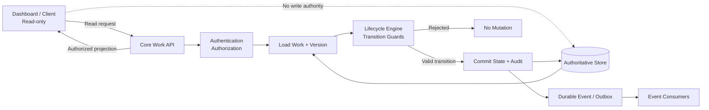

# WORK 70 — WP70-KA — RUNTIME BOUNDARY DIAGRAM

Status: DRAFT companion to WORK70_KA_ARCHITECTURE_CONTRACT_V1.md
Owner: Ka / AI-02
Date: 2026-10-31

## Component and authority map



## Command sequence

```mermaid
sequenceDiagram
  participant C as Client
  participant A as Core API
  participant S as Authoritative Store
  participant E as Lifecycle Engine
  participant O as Outbox/Event
  C->>A: Command + command_id + expected_version
  A->>A: Authenticate and authorize actor
  A->>S: Load Work and current version
  A->>A: Check idempotency and version
  A->>E: Evaluate canonical transition and guards
  alt Guard accepted
    E-->>A: Valid transition decision
    A->>S: Commit state + audit atomically
    A->>O: Persist event for delivery
    A-->>C: Accepted + transition/version/audit refs
  else Guard rejected
    E-->>A: Rejection reason
    A-->>C: Rejected; state unchanged
  end
```

## Boundary rules
- Dashboard reads through Core only; no direct Engine or database access.
- Actor identity is derived from the authenticated principal.
- Engine evaluates lifecycle rules; Core remains the API/security/persistence boundary.
- Event consumers cannot become alternate lifecycle authorities.
- Component tests do not prove the cross-layer semantic contract.

## Reconciliation checklist
- [ ] Compare canonical state names and edges with the approved state machine.
- [ ] Compare lifecycle gate names and meanings with the gate matrix.
- [ ] Map proposed command fields to existing Core request conventions.
- [ ] Confirm transaction/version and idempotency behavior with actual implementation.
- [ ] Confirm audit/event persistence and delivery/replay behavior.
- [ ] Confirm Dashboard is read-only in routes, adapter, and UI actions.
- [ ] Bind each QE test to a reproducible fixture and authoritative oracle.

No implementation or release approval is implied.
