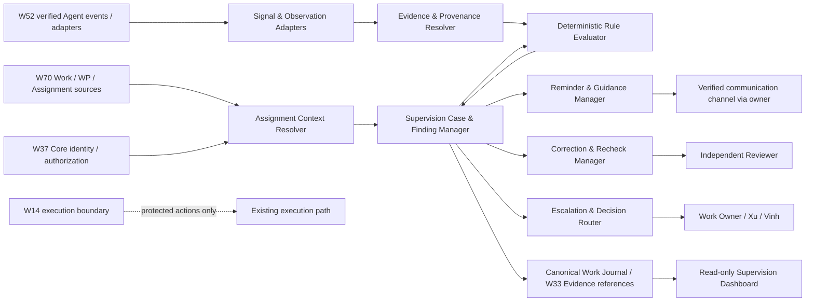

# KIẾN TRÚC NGHIỆP VỤ THEO DÕI & HƯỚNG DẪN AGENT / AGENT WORK SUPERVISION AND GUIDANCE

- Work: 802001
- Artifact ID: W802001-ARCH-AOG-001
- Version: 2.0 — LOGICAL TECHNICAL ARCHITECTURE PROPOSAL FOR INDEPENDENT REVIEW
- Date: 2026-11-18
- Status: DRAFT — AUTHORIZED ARCHITECTURE EXPLORATION; INDEPENDENT REVIEW PENDING; NOT APPROVED; NO BUILD
- Authority: Vinh

## 1. Mục đích
Chuẩn hóa cách ROOM-HOP theo dõi Agent trong suốt quá trình nhận việc và thi công; phát hiện sớm sai nghiệp vụ, lệch tiến độ, thiếu hồ sơ/bằng chứng hoặc hành vi vượt quyền; nhắc nhở và hướng dẫn Agent điều chỉnh theo nguồn chuẩn của Work; kiểm tra lại và lưu vết đến khi hoàn tất hoặc escalated.

AOG (Agent Operational Gate) là tên lớp kiểm soát/điểm quyết định trong nghiệp vụ này, không phải toàn bộ sản phẩm. Nghiệp vụ trung tâm là Agent Work Supervision & Guidance (theo dõi và hướng dẫn Agent trong quá trình làm việc).

## 2. Đối tượng và context bắt buộc
Mỗi assignment cần có Work ID, WP/Assignment ID, Agent/Actor ID, vai trò được xác minh, người giao việc, scope, deliverables, deadline/checkpoints, acceptance criteria, canonical sources/revisions, dependencies, risk level và nơi ghi nhật ký/evidence. Thiếu dữ liệu phải tạo clarification/blocker; không tự suy diễn.

## 3. Quy trình nghiệp vụ end-to-end
1. ASSIGNMENT INTAKE: tiếp nhận nhiệm vụ, owner, Agent, phạm vi, đầu ra, thời hạn và quyền.
2. BASELINE & BRIEFING: đọc Work Manifest, Biên bản/Decision, kế hoạch, WP, tiêu chuẩn, source of truth; gửi hướng dẫn trước khi Agent bắt đầu.
3. ACKNOWLEDGEMENT: ghi nhận Agent đã nhận việc/hiểu yêu cầu; nếu chưa xác nhận hoặc hiểu sai thì làm rõ trước bước có rủi ro.
4. CHECKPOINT SETUP: xác định mốc kiểm tra theo rủi ro, thời lượng, dependency và deliverable; tránh giám sát dày gây lãng phí.
5. PROGRESS OBSERVATION: thu thập status, hoạt động, artifact, commit/tool evidence, journal, blocker và thời điểm cập nhật.
6. COMPLIANCE & DRIFT CHECK: so sánh thực tế với assignment, quy trình, cấu trúc W70, quyền, source revision, acceptance và checkpoint.
7. CLASSIFY & REMIND: phân loại ON_TRACK / AT_RISK / BLOCKED / DEVIATION_FOUND / NO_RESPONSE; gửi nhắc nhở đúng người, đúng việc, nêu căn cứ và hạn xử lý.
8. GUIDED CORRECTION: hướng dẫn sửa theo thứ tự, dẫn đúng tài liệu/path/tiêu chí; chỉ rõ điều phải dừng và việc an toàn vẫn được làm.
9. CORRECTION SUBMISSION: Agent nộp phản hồi và bằng chứng sửa; không coi lời xác nhận đơn thuần là hoàn thành.
10. RECHECK: đối chiếu lại artifact/evidence, yêu cầu reviewer độc lập nếu cần.
11. RESUME / CLOSE / ESCALATE: cho tiếp tục khi đạt điều kiện; xác nhận hoàn thành khi evidence đủ; escalate khi lặp lỗi, quá hạn, im lặng hoặc vượt thẩm quyền.
12. JOURNAL & LEARNING: ghi đầy đủ chuỗi theo dõi; đề xuất cập nhật hướng dẫn/policy qua phê duyệt, không tự thay đổi chuẩn.

## 4. Quy tắc nhắc nhở
- Reminder 1 — nhắc nhẹ: sắp đến checkpoint/deadline hoặc thiếu cập nhật; nêu việc cần cập nhật và thời hạn.
- Reminder 2 — cảnh báo: đã trễ mốc hoặc có dấu hiệu lệch; nêu evidence và yêu cầu kế hoạch khắc phục.
- Correction Notice — yêu cầu điều chỉnh: xác định rõ quy tắc bị vi phạm, hành động sai, cách sửa, đầu ra cần nộp và điều kiện recheck.
- Escalation — chuyển cấp: lỗi lặp lại, không phản hồi, vi phạm quyền/an toàn, hoặc ảnh hưởng critical path; chuyển người có thẩm quyền.
Ngưỡng thời gian và số lần nhắc phải được DEFINE theo loại Work/risk; không hard-code một lịch nhắc chung cho mọi Agent.

## 5. Hợp đồng finding/hướng dẫn sửa sai
Mỗi finding/reminder gồm: ID; Work/WP/assignment; Agent; timestamp; checkpoint; status; severity; rule/source path và version; mô tả sai lệch; evidence quan sát; expected behavior; tác động; việc phải dừng; việc vẫn được phép làm; hướng dẫn sửa theo thứ tự; deliverable/evidence phải nộp; deadline; owner; reviewer; recheck method; exit criteria; escalation condition.
Không dùng lời nhắc chung chung như “làm đúng quy trình”. Nếu chưa đủ căn cứ, đánh dấu UNKNOWN/NEEDS_CLARIFICATION và hỏi người có thẩm quyền.

## 6. Trạng thái theo dõi assignment
ASSIGNED → BRIEFED → IN_PROGRESS → ON_TRACK / AT_RISK / BLOCKED / DEVIATION_FOUND → REMINDED / COACHED → CORRECTION_SUBMITTED → RECHECK → RESUMED / VERIFIED_DONE / ESCALATED.
Đây là operational workflow của assignment, không thay thế lifecycle Work 70 và không tự tạo PASS cho Gate vòng đời.

## 7. Phân tầng kiểm soát
- Work 70 governance: lifecycle, cấu trúc, tài liệu, Gate vòng đời và trạng thái Work.
- Assignment supervision: theo dõi Agent, checkpoint, tiến độ, nhắc nhở, hướng dẫn, correction và escalation.
- Policy/decision control: xác định hành động nào được phép, cần review hoặc phải dừng.
- Enforcement: nếu có, phải chặn tại execution boundary; prompt/dashboard không phải enforcement.
- Journal/evidence: lưu vết có thể đọc lại, truy nguyên actor, thời gian, source và kết quả.

## 8. Phân biệt với Work 70
W70 G0–G9 kiểm soát chuyển pha Work; DOC-057 kiểm soát điều kiện tham gia/nhận assignment; DOC-033 điều chỉnh tài liệu/lưu trữ; DOC-035 là nhật ký thi công cấp Work. DOC-096 là tài liệu Retrieval/DecisionRAG, không phải chuẩn phiên/nhật ký. W802001 chuẩn hóa nghiệp vụ giám sát/hướng dẫn Agent trong khi thực hiện assignment và dùng đúng các chuẩn W70 làm căn cứ. Các lớp bổ sung nhau, không thay thế nhau.

## 9. Nguyên tắc dữ liệu và trách nhiệm
- Mọi status phải gắn source, timestamp, owner và freshness.
- Agent tự báo cáo không đủ để xác nhận tiến độ/hoàn thành; cần đối chiếu evidence.
- Không suy diễn identity, không trao quyền ngoài assignment.
- Không cho Agent tự đóng finding nghiêm trọng hoặc tự duyệt correction của chính mình.
- Không xóa lịch sử sai; correction là bản ghi nối tiếp.
- Nhật ký là nguồn truy vết; dashboard chỉ là read-only projection.

## 10. Nội dung cần khảo sát trước thiết kế kỹ thuật
Cách lấy tín hiệu tiến độ từ Agent/Room; mô hình assignment/checkpoint; nơi lưu reminder và correction; cách xác thực Agent identity; quyền đọc artifact/journal; cơ chế reviewer/escalation; các execution paths có thể cần enforcement; hành vi khi Agent offline hoặc nguồn dữ liệu stale. Không chọn công nghệ trước READ/TRACE.

## 11. Baseline and architecture scope

- DEFINE baseline: W802001-DEF-001 v0.3, APPROVED BY VINH on 2026-11-18. The approved business rules govern supervision of Agent assignments: briefing, acknowledgement observation, checkpointing, progress observation, finding, reminder/guidance, correction, recheck, escalation and journal/evidence.
- This v2.0 is a logical architecture proposal created under D802001-001 and W70 DOC-047. It is not a production design approval, API contract, schema approval, runtime capability claim or BUILD authorization.
- Product objective: provide a traceable supervision layer that can observe verified assignment/activity/evidence signals, compare them with the approved assignment and business policy, guide the responsible Agent, track correction and route decisions to the correct authority.
- The product must remain useful in read-only/manual mode when event delivery, adapters or automation are unavailable. Missing telemetry is NOT_OBSERVED/UNKNOWN, not proof of inactivity or misconduct.

## 12. Source baseline and confidence

### Governing sources read

- W70 DOC-001: authority, canonical source and ownership boundaries.
- W70 DOC-004 and DOC-005: lifecycle gate matrix and authoritative state machine.
- W70 DOC-033 and DOC-035: canonical documentation/storage and append-only Work journal requirements.
- W70 DOC-042, DOC-043 and DOC-044: execution orchestration, AI role/permission matrix and assignment contract template.
- W70 DOC-047: Architect phase entry/exit protocol and required architecture outputs.
- W70 DOC-057 and DOC-063: Work Entry policy and proposed execution authorization/deny-recovery design.
- W70 D70-017: Hybrid AI Dispatch target direction; preserve existing AI conversation/session where a verified adapter supports it, prefer native permission/manual handoff, avoid new API cost.
- W70 D70-023: current ownership baseline separating Work lifecycle, Agent orchestration, deterministic workflow, Core, execution boundary and evidence. It is recorded as an architecture baseline with independent review pending; this proposal does not upgrade its status.
- W70 DOC-071/DOC-072: Core owner/runtime composition, Work APIs, authorization, persistence and integration paths have unresolved or NOT VERIFIED items.
- W112 Cross-Work Integration Contract: assignment/event/evidence correlation, provenance, idempotency and explicit unresolved transport/API/storage/lock ownership.

### Confidence labels

- DOCUMENTED: requirements and ownership statements explicitly present in the cited canonical documents.
- SOURCE-TRACE OBSERVED: a specific repository document or source path was read at a recorded revision.
- NOT VERIFIED: runtime route, deployed composition, provider/adapter capability, persistence, event transport, scheduler, authorization enforcement or live end-to-end behavior not proven.
- PROPOSED: logical components and contracts in this architecture; not existing implementations.

### Source revision pins used for this proposal

| Source | GitHub main blob SHA read |
|---|---|
| W70 DOC-001 | 0131e012ce67ce5dd8c17a258fb592c7f3d3641a |
| W70 DOC-004 | d55e84002fe1a0152fab4de270faf8af0a13eff5 |
| W70 DOC-005 | 5f7a6e15910186872c10a639c43ebc04498c3585 |
| W70 DOC-006 (D70-017 / D70-023) | 53c5a7cfdb02bc38e4213010004e1f0ad137d87f |
| W70 DOC-033 | 599caa7da6dd2c81fc5440481e79fe15b92c94dd |
| W70 DOC-035 | f910ef171ff47390a83d689447e9b7b8b10244c8 |
| W70 DOC-042 | a9a949b56ae615cdc5aced0ba1563ab45e97ab8f |
| W70 DOC-043 | 883123766f8c5457e6f905ae15682d718aa9acfa |
| W70 DOC-044 | 508cbde08e1f376cdeba9475330aa880a9f63797 |
| W70 DOC-047 | 23e083c02373ce5ff33d1397852f1eec9c526301 |
| W70 DOC-057 | 23798cc1ff90445ab8c1593c283cd6a1b83a1fca |
| W70 DOC-063 | 55be0bbcd6c215f5f1158a4e74738b9a4a750cfd |
| W70 DOC-071 | 12f11320dc9da89b27de21313b698224d74519ce |
| W70 DOC-072 | 513d65d3d360dcb732607d07e2eee558cd02f005 |
| W112 Cross-Work DOC-001 | 6340a7b054a37540da8c16d0b9743266b0765c97 |

These pins identify the exact source contents read for this draft. Re-fetch and compare before relying on them after any source update.

No endpoint, event broker, database, queue, scheduler, provider, model, credential or deployment topology is asserted to exist.

## 13. System ownership and bounded context

| Capability / source of truth | Owning Work or authority | W802001 interaction | Boundary |
|---|---|---|---|
| Work identity, Work/WP lifecycle, lifecycle gates and decisions | W70 / authoritative Core path per approved contracts | Read and reference; report findings against them | W802001 never creates a competing Work/WP registry or changes W70 G0–G9 |
| Assignment contract, dispatch and Agent-to-Agent event/provider orchestration | W70 governance; W52 orchestration ownership baseline (D70-023 subject to independent review) | Consume assignment references and verified delivery/ACK/progress signals | Do not implement a second dispatcher, provider adapter or assignment authority |
| Deterministic workflow graph and step execution | W16 ownership baseline (D70-023) | Request or consume workflow outcomes only through a verified contract | Do not embed a second generic workflow engine |
| Identity and authoritative authorization | W37/Core ownership baseline; DOC-043/DOC-063 constraints | Consume verified principal, role, permission and scope references | No identity inferred from display name, model name, chat text or client-supplied role |
| Protected action execution | W14 execution-boundary ownership baseline | Submit a recommendation/decision reference where supported | W802001 does not directly bypass the execution boundary or claim enforcement |
| Evidence object storage and cross-Work evidence hub | W33 ownership baseline; W70 EVIDENCE remains canonical index | Reference evidence IDs/URIs, provenance, hash and verification status | Do not create a competing evidence store or mark RECORDED as VERIFIED |
| Cross-Work contract mapping and correlation | W112 ownership baseline | Use stable Work/task/assignment/event/correlation references | Do not copy authoritative state into a second register |
| Retrieval/ranking/evidence packaging | W103 ownership baseline | Optional read-only source retrieval if approved and verified | Retrieval is not policy authority, Agent runtime or finding closure authority |
| Agent supervision policy, finding, checkpoint, reminder/guidance, correction/recheck and escalation workflow | W802001 bounded context | Own the supervision-specific case state and decision history | Assignment and Work lifecycle remain references, not duplicated aggregates |
| Dashboard projection | W802001 view contract, following W70 read-only rule | Read-only view of canonical supervision and source records | No state mutation, authorization or gate evaluation from UI |

D70-023 is not silently treated as an approved integration contract. If an owner or interface conflicts with the relevant Work's approved decision, stop at the boundary and record an architecture finding.

## 14. Logical architecture components

| Component | Responsibility | Authority / mode | Main output |
|---|---|---|---|
| Assignment Context Resolver | Resolve Work/WP/assignment references, owner, role, scope, source revisions, acceptance criteria and dependencies | Read-only; uses authoritative owners | Resolved context or NEEDS_BRIEFING/BLOCKED |
| Briefing Builder | Build a structured briefing from approved assignment and canonical sources | Advisory; no permission grant | Briefing package and missing-input list |
| Signal/Observation Adapters | Read ACK, progress, tool activity, commits, artifacts, tests, blockers and journal signals from verified sources | Read-only by default; each adapter capability separately verified | Observation with source, timestamp, freshness and trust level |
| Evidence/Provenance Resolver | Resolve canonical path/URI, commit/blob/hash, producer, method, environment and verification state | Read-only; does not promote evidence status | Evidence references and provenance gaps |
| Supervision Rule Evaluator | Apply approved taxonomy, severity, checkpoint and escalation rules to observations | Deterministic rules are authoritative; LLM may suggest classification/explanation only | Finding candidate, severity rationale, next action |
| Supervision Case & Finding Manager | Maintain supervision-specific case/finding lifecycle linked to assignment_id | Owns W802001 state only | Case/finding status and history |
| Reminder & Guidance Manager | Prepare and track upcoming/missed/deviation/correction/escalation notices; deduplicate by logical key | Send only through verified channel and permitted scope | Reminder/guidance record and delivery outcome |
| Correction & Recheck Manager | Track correction submission, evidence, reviewer independence and recheck result | Agent cannot self-close; reviewer authority required | Recheck record and close/reopen/block result |
| Escalation & Decision Router | Route unresolved/high-risk issues to Work Owner, Xu or Vinh according to authority | No self-approval of reserved decisions | Escalation record and decision reference |
| Journal/Evidence Linker | Link every material action to the canonical Work journal and evidence register | Append-only business history; reuse DOC-035/W70 EVIDENCE conventions | Traceable journal/evidence references |
| Read-only Supervision Dashboard | Project cases, freshness, findings, reminders, blockers and correction status | Read-only projection | Visible status with provenance and stale/unavailable markers |

The components above are logical responsibilities. They may be implemented inside existing owning services or through adapters; this document does not mandate separate microservices or processes.

## 15. Logical context and data flow

The diagram describes logical data flow only. Dashed execution-boundary relation is not an implemented integration.

### Normal supervision sequence

1. Read the authoritative assignment contract and resolve its Work/WP, scope, owner, recipient, source revision, permissions and acceptance criteria.
2. If required briefing inputs are absent, create a NEEDS_BRIEFING condition; do not infer acknowledgement or start permission.
3. Observe verified events and artifacts. Keep source timestamp, recorded timestamp, producer, identity assurance, source revision and freshness.
4. Compare observed facts with the approved assignment, Work standards and checkpoint expectations.
5. If a rule matches, create or update a finding with evidence and severity rationale. If evidence is insufficient, use UNKNOWN/NEEDS_TRACE.
6. Prepare a deduplicated reminder/guidance/correction notice. Delivery is not assumed until the channel returns attributable evidence.
7. Track Agent response and correction as separate records. Do not equate message delivery, acknowledgement, artifact upload or self-report with acceptance.
8. Route correction to a reviewer independent of its producer where required; record PASS/FAIL/BLOCKED and rationale.
9. Close only when the approved criteria are met; otherwise reopen, block or escalate.
10. Append the event to the canonical journal and link evidence; update the read-only dashboard projection.

## 16. Conceptual data model and source-of-truth rules

The following are conceptual records, not approved database tables or API schemas:

- SupervisionCase: supervision_case_id, work_id, wp_id, assignment_id, policy_version, owner, current_supervision_status, opened_at, last_observed_at, closed_at.
- Checkpoint: checkpoint_id, assignment_id, expected_outcome, due_at, timezone, trigger_condition, risk_basis, quiet_window, owner and evidence_expectation.
- Observation: observation_id, assignment_id, source_owner, source_ref, event_ref, occurred_at, recorded_at, actor_ref, identity_assurance, source_revision, freshness, payload_ref and trust_status.
- Finding: finding_id, supervision_case_id, assignment_id, correlation_id, taxonomy, severity, confidence, rationale, evidence_refs, owner, reviewer, state and due/checkpoint reference.
- Reminder: reminder_id, finding_id, recipient_ref, reminder_type, checkpoint_id, dedupe_key, prepared_at, delivery_status, channel_ref and delivery_evidence.
- Correction: correction_id, finding_id, requested_actions, allowed_scope, prohibited_actions, assignee_ref, submitted_artifacts, submitted_at and state.
- Recheck: recheck_id, correction_id, reviewer_ref, independence_basis, method, source_revision, result, evidence_refs and decided_at.
- Escalation: escalation_id, finding_id, trigger, target_authority, requested_decision, evidence_refs, state and outcome_ref.
- Audit/Journal reference: canonical journal entry ID/path and evidence IDs; do not create a second authoritative Work-wide journal.

Source-of-truth invariants:
1. W70/Core owns Work/WP/gate truth; the approved assignment owner owns assignment dispatch/ACK truth.
2. W802001 owns only its supervision cases, findings, checkpoint policy application, reminders/guidance, correction/recheck and escalation records.
3. Assignment IDs, Work IDs, identity IDs, evidence IDs and source revisions are references to their authoritative owners.
4. Evidence object bytes and canonical metadata remain with the approved evidence owner; W802001 stores references and verification observations only.
5. A dashboard/cache/snapshot is never authoritative and must expose freshness and source revision.

## 17. State model separation and mapping

W802001 must not replace or silently translate these separate state domains:

- Work/Phase/Gate/WP states: W70 DOC-004/DOC-005.
- Assignment dispatch/receipt/execution states: approved assignment/orchestration contract (DOC-044 and the relevant W52/W112 contract once ownership/interface is confirmed).
- Supervision case/finding/reminder/correction/recheck states: W802001 DEFINE v0.3.

The DEFINE terms ASSIGNED, BRIEFED and IN_PROGRESS are supervision context milestones, not permission to create a second authoritative assignment lifecycle. ON_TRACK, AT_RISK, BLOCKED and DEVIATION_FOUND are supervision assessments/overlays; they do not mutate the source assignment or Work state. REMINDED/COACHED are events/actions, not automatic assignment-state transitions. CORRECTION_SUBMITTED and RECHECK belong to the finding/correction workflow. VERIFIED_DONE is a supervision conclusion and must not be rendered as assignment ACCEPTED, WP DONE or Work Gate PASS without the owning authority's separate evidence and decision.

Any cross-domain status mapping must be explicit, versioned, reversible and tested; unknown or ambiguous states remain UNKNOWN/BLOCKED.

## 18. Reminder, scheduling and anti-spam behavior

- Checkpoints are created from assignment deadlines, deliverables, risk and agreed working/quiet hours; no universal SLA or fixed frequency is introduced.
- A reminder is eligible only when a due condition or new evidence-backed finding exists and no equivalent current reminder is active.
- Proposed deduplication key: assignment_id + finding_id (when applicable) + checkpoint_id + reminder_type + policy_version. Exact persistence/uniqueness enforcement remains an interface decision.
- A new reminder requires a material state change, new evidence, a new checkpoint or a changed deadline; no repeated reminder for the same unchanged condition.
- A known system dependency blocker routes to its dependency owner; it does not count as Agent misconduct or trigger repeated pressure on the Agent.
- Offline/quiet periods and timezone are respected as defined in DEFINE v0.3.
- Delivery states must distinguish PREPARED, SUBMITTED_TO_CHANNEL, DELIVERED (only with channel evidence), DELIVERY_FAILED and DELIVERY_UNKNOWN. No channel evidence means do not claim delivered.
- Scheduler ownership, durable timers, retry policy and delivery guarantees are OPEN / NOT DECIDED. Do not implement a local timer as an assumed system scheduler.

## 19. Identity, authorization and security

- Resolve identity and role from the approved identity authority; display name, model label, speaker text, self-asserted identity or client payload is not authentication.
- Bind every observation and action to Work, assignment, actor, scope, source revision and correlation reference.
- Read-only observation is the default. Any protected write/action must be authorized at the actual execution boundary by the owning system, consistent with DOC-057/DOC-063 and W70 DOC-005.
- A reminder or guidance message is not a permission grant. A DENY is not converted to ALLOW by an LLM explanation or dashboard action.
- LLM output may summarize, classify or draft guidance; deterministic policy and authorized human roles decide state changes, finding closure, permission, scope and escalation.
- Secrets/credentials are never copied into prompts, journal, evidence or review packages.
- Threat review must include spoofed identity, prompt/tool injection in untrusted content, cross-Work data leakage, privilege escalation, evidence tampering, replay/duplicate events and reviewer conflict.

## 20. Failure, recovery and data-quality behavior

| Condition | Required behavior |
|---|---|
| Event/adapter unavailable | Mark signal source UNAVAILABLE/STALE; keep last-known timestamp; do not infer no response |
| Assignment or identity unresolved | NEEDS_BRIEFING/BLOCKED; no protected action |
| Source revision changed | Mark observation stale; re-resolve canonical source and require re-baseline if material |
| Duplicate event/retry | Idempotent processing by stable event/idempotency reference; no duplicate finding/reminder |
| Out-of-order event | Compare occurred_at, recorded_at, causation and source/aggregate revision; do not regress state silently |
| Evidence missing/hash mismatch | NOT_VERIFIED/REJECTED; do not close finding or claim PASS |
| Reminder channel failure | DELIVERY_FAILED/UNKNOWN; preserve draft and route blocker; do not claim Agent was notified |
| Persistence/journal unavailable | Do not claim event recorded; protected state change/closure must fail closed or remain pending |
| Reviewer unavailable/conflicted | Keep RECHECK pending/BLOCKED; request independent reviewer or escalate |
| Core/owner service unavailable | Read-only cached context may be shown with timestamp; no authoritative write or gate promotion |

Recovery must be idempotent, auditable and owner-approved where it changes authoritative state. Retry, lease, queue and transaction mechanisms are not selected until their owning service and contract are verified.

## 21. Architecture decision records (provisional)

| ADR | Decision proposed | Alternatives considered | Rationale | Status |
|---|---|---|---|---|
| ADR-802001-01 | Build a bounded Agent Supervision context, not a second Work/task/assignment platform | Standalone parallel registry; embedding all logic into generic dispatcher | Preserve W70 and D70-023 ownership; keep W802001 focused on supervision-specific lifecycle | PROPOSED — REVIEW PENDING |
| ADR-802001-02 | Separate authoritative assignment state from supervision/finding state | One combined state machine | Prevent conflict with DOC-044/W112 and W70 DOC-005 | PROPOSED — REVIEW PENDING |
| ADR-802001-03 | Deterministic policy evaluation is authoritative; LLM is assistive | LLM-only decisioning | Reproducibility, traceability, controlled authority and explainable findings | PROPOSED — REVIEW PENDING |
| ADR-802001-04 | Reuse canonical journal/evidence ownership; store references, not competing copies | New W802001 journal/evidence store | DOC-033/DOC-035 and W33 ownership | PROPOSED — REVIEW PENDING |
| ADR-802001-05 | Dashboard is read-only; all protected actions are enforced at owner execution boundary | UI/prompt-based enforcement | W70/DOC-063 security and source-of-truth boundaries | PROPOSED — REVIEW PENDING |

These ADRs are proposals for independent review, not binding system decisions.

## 22. Alternatives and trade-offs

- **Alternative A — Standalone W802001 orchestrator with its own assignment registry, event bus and database:** rejected for now because it duplicates W70/W52/W37/W33 responsibilities, creates conflicting sources of truth and requires unverified infrastructure.
- **Alternative B — Put all supervision rules inside W52 Agent orchestration:** not selected as the default because supervision policy, finding lifecycle, evidence-based correction and independent recheck are a distinct business bounded context; ownership integration still needs W52 owner review.
- **Alternative C — Bounded supervision context integrated through verified owner contracts:** selected as the logical proposal. It consumes authoritative Work/assignment/identity/event/evidence references, owns only supervision-specific records, and sends guidance/escalation through verified channels. This minimizes duplication and allows manual/read-only operation before automation.

## 23. Success measures and non-functional requirements

Metrics to instrument or report, without inventing targets at this stage:
- Briefing completeness rate and time-to-acknowledgement (measured only where receipt evidence exists).
- Checkpoint coverage and observation freshness.
- Finding precision/false-positive rate, with reviewer disposition.
- Duplicate reminder rate and delivery evidence rate.
- Correction cycle time and first-pass recheck rate.
- Independent reviewer coverage for S0/S1 and material changes.
- Journal/evidence trace completeness.
- Unauthorized action attempts denied at the true execution boundary (requires runtime evidence).
- Data isolation, privacy/security incidents and operational availability.

Numeric targets, SLOs, retention periods, latency budgets, volume assumptions and cost ceilings remain OPEN until discovery data, owner input and Vinh approval.

## 24. Open architecture decisions and blockers

| ID | Question / missing condition | Current status | Owner to resolve |
|---|---|---|---|
| OA-01 | Confirm D70-023 ownership and W52/W16 interface boundaries with their accountable owners/reviewers | REVIEW PENDING | Xu + independent reviewer; relevant Work owners |
| OA-02 | Identify canonical event source/transport, delivery guarantee and replay contract | NOT DECIDED / NOT VERIFIED | W52 owner |
| OA-03 | Verify authoritative Work/assignment/ACK/read APIs and Core runtime composition | NOT VERIFIED | W37/Core owner |
| OA-04 | Confirm identity assurance and server-side permission contract for observation and protected actions | NOT VERIFIED | W37 + W14 owners |
| OA-05 | Confirm canonical storage for supervision records, journal links and evidence metadata | NOT DECIDED | W37/W33 owners |
| OA-06 | Confirm reminder channel capability, receipt semantics, quiet hours, scheduler and retry ownership | NOT VERIFIED / NOT DECIDED | W52/provider owner |
| OA-07 | Define cross-domain status mapping without duplicating assignment or Work state | PROPOSED; REVIEW PENDING | Xu + Vibe / Ka review |
| OA-08 | Confirm retention, privacy classification, access boundaries and tamper-evidence | OPEN | W33/W37 + Vinh |
| OA-09 | Establish baseline volumes, false-positive tolerance and measurable SLO targets | OPEN | Xu + Work owners + Vinh |
| OA-10 | Confirm whether architecture requires a separate deployable service or can be hosted as a bounded module in an existing owner service | OPEN; no topology selected | Architecture authority + owners |

No blocker above is solved by inventing an endpoint, schema, owner acceptance or local substitute. Read-only source tracing may continue; implementation-dependent items remain blocked.

## 25. G3 architecture exit criteria

G3 must not be marked PASS until all applicable items are evidenced and the authorized architecture authority decides:

1. All approved DEFINE requirements map to components, data, events, controls and verification criteria.
2. Work/assignment/identity/evidence ownership is reconciled with W70, W52, W16, W37, W14, W33 and W112.
3. Assignment and supervision state models are separate and mappings are explicit.
4. Data model, source of truth, retention, access classification and audit strategy have owners.
5. Interfaces have schemas, authentication/authorization, idempotency, versioning, error and recovery semantics—or are explicitly excluded from G3 with a recorded owner and risk accepted by authority.
6. Reminder delivery, scheduler, quiet hours and anti-spam behavior are designed without unsupported capability assumptions.
7. Security/threat review, failure modes, observability and test seams are complete.
8. Alternatives and ADRs are reviewed; unresolved risks have owners and disposition.
9. Independent architecture review findings are resolved or explicitly accepted by the proper authority.
10. Architecture artifacts are exact-readback verified, registered and journaled.

G2 remains NOT ASSESSED/PASS in this exploration. G3 remains NOT READY until the exit criteria and authority decision are complete.

## 26. Explicit non-authorization

This architecture proposal does not authorize:
- Any code/source/runtime/API/MCP/configuration/permission/credential changes.
- Creating a new database, queue, event broker, scheduler, service or provider account.
- Sending automated reminders or dispatching agents.
- Changing Work 70, W52, W16, W37, W14, W33, W112 or other Work ownership/contracts.
- Adding API cost or recurring subscription.
- Marking G2/G3/G4 PASS, starting BUILD, merging/deploying or accepting/releasing a product.

**Current disposition:** LOGICAL ARCHITECTURE PROPOSAL WRITTEN FOR INDEPENDENT REVIEW; SOURCE/OWNER TRACE PARTIAL; RUNTIME CAPABILITIES NOT VERIFIED; VIBE ACK PENDING; G2/G3 NOT PASS; BUILD NOT AUTHORIZED.
